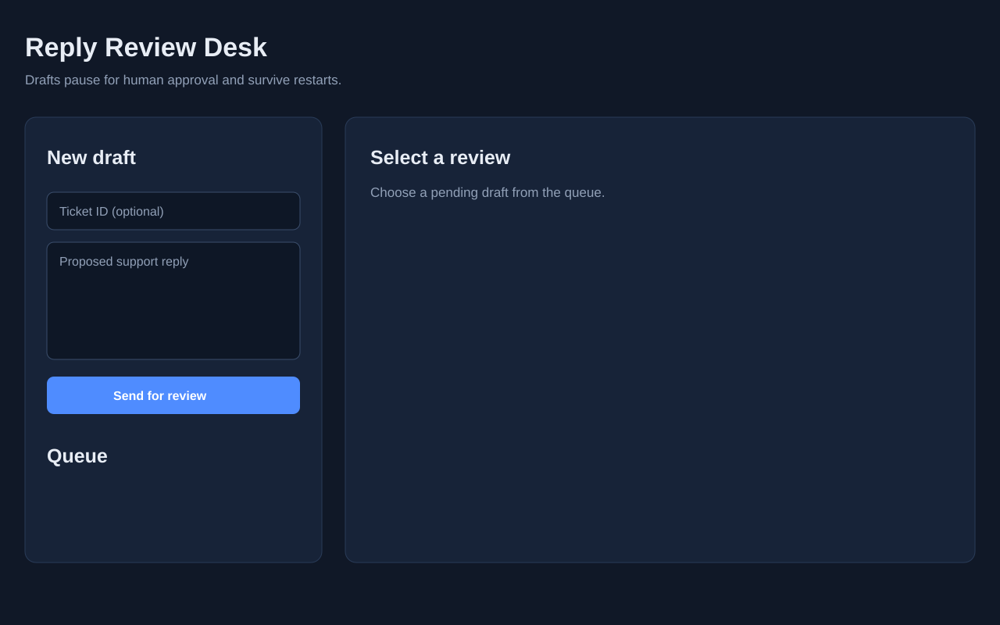
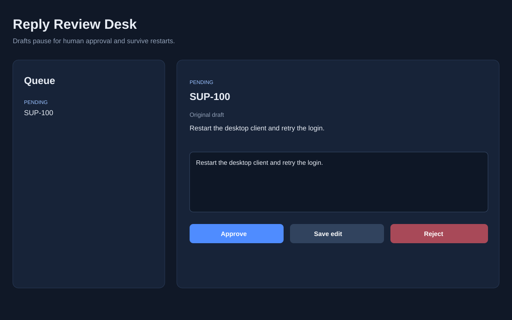

# LangGraph Approval Workflow

A local support reply review queue. Submit a draft, close the program, then approve, edit, or reject the draft from another process. LangGraph pauses at an interrupt and stores the checkpoint in SQLite. No model credentials are required.

## Run

Use Python 3.11 or newer in a virtual environment:

```sh
python -m pip install -e ".[dev]"
approval start "Please restart the desktop client and try again."
approval status REQUEST_ID
approval review REQUEST_ID edit --text "Restart the client. If the problem persists, send the error code."
approval status REQUEST_ID
python -m pytest
```

Replace REQUEST_ID with the ID printed by the first command. Review decisions are approve, edit, or reject. A rejected draft has no approved reply. Use --db PATH before the subcommand to choose a different SQLite file.

## Web API and UI

Start the local review desk with:

    uvicorn api:app --reload

Open http://127.0.0.1:8000. The UI creates drafts, shows the review queue, and lets a reviewer approve, edit, or reject a draft. The API provides POST /reviews, GET /reviews, GET /reviews/{id}, and POST /reviews/{id}/decision. Interactive API documentation is available at /docs.

## Advanced local workflow

The graph now runs this sequence before review:

    classify -> safe local tools -> policy check -> human review

Classification adds a category and urgency. The policy node blocks drafts containing secret-like phrases such as `password:` or `api key`. Tool execution is deterministic and local, so it is safe to replace later with authenticated customer or service-status integrations. Every completed review stores an audit event.

The API has a small local RBAC layer. Send `X-User-Id: customer-demo` to create and view drafts, `X-User-Id: reviewer-demo` to make decisions, or `X-User-Id: manager-demo` to assign a reviewer. The manager endpoint is `POST /reviews/{id}/assign`. Requests without a user ID return 401, and unauthorized decisions return 403.

The review registry uses a relational SQLite schema for local development and is isolated behind the API layer, making it straightforward to move to PostgreSQL later. Cloud deployment is intentionally outside this repository's current scope.

### UI screenshots





## Design

The request ID is the LangGraph thread ID. Each command opens the same SQLite checkpoint database. The review node pauses with the original draft and resumes using the reviewer's decision. A completed request rejects a second sequential review.

This is a single-operator demo. It stores drafts as plaintext locally and does not send messages. A shared deployment would need authentication, authorization, and concurrency controls.
